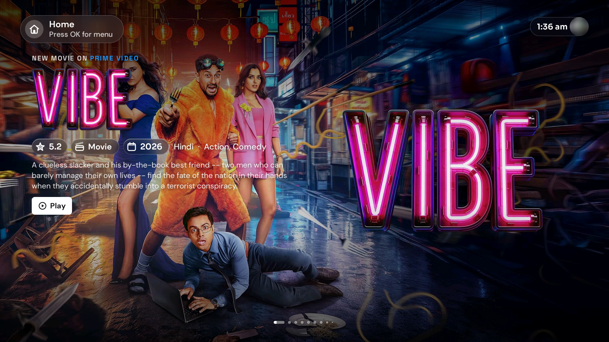
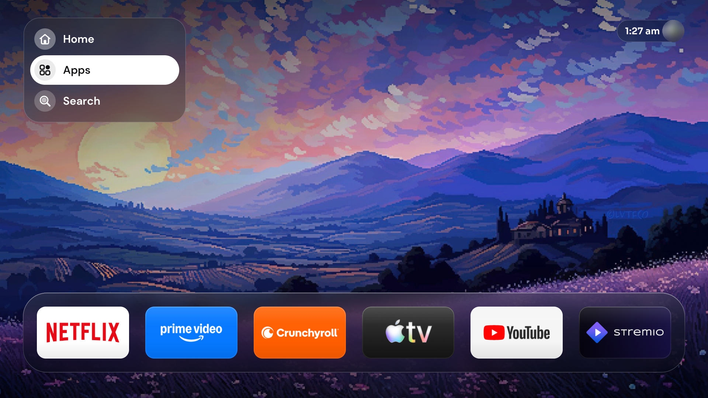
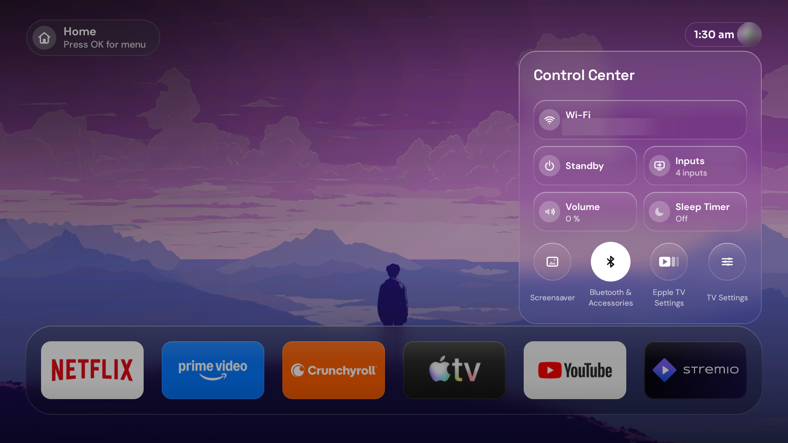

<p align="center">
  
</p>

<p align="center">
  <a href="https://github.com/muhibtasam/epple-tv-launcher/releases/latest"></a>
  
  
  <a href="LICENSE"></a>
</p>

# Epple TV

**Epple TV is a home screen (launcher) for Android TV.** It replaces the busy stock home screen with a calm, glassy
interface: your favourite streaming apps in one row, big artwork for what is new on them, a Continue Watching row built
from what you actually watched, and a Control Center for everyday TV controls, all usable with a normal TV remote.

It is made for people who watch through several streaming apps (Netflix, Prime Video, Crunchyroll, YouTube, Stremio and
others) and want one tidy place to start from, without sponsored rows.

> Epple TV is an independent open-source project. It is not affiliated with, endorsed by or connected to Apple, Google,
> TCL, TMDB, JustWatch or any streaming service. App names and logos shown belong to their owners.

## Screenshots

| | |
|---|---|
|  |  |
| **Home**: your apps in a glass row, with artwork, rating and a summary for what is new or popular on the focused app. | **Full artwork**: press Up for the full picture of the current title, with Play to open it in its app. |
|  |  |
| **Menu**: Home, Apps and Search, opened from the Home badge. | **Apps**: every installed app in one grid. |
|  |  |
| **Control Center**: Wi-Fi, standby, inputs, volume, sleep timer and shortcuts. | **Screensaver**: your pictures with the time and date. |

*Screenshots were taken from the running app on a TCL C6K. The Wi-Fi name and profile picture are blurred for privacy;
the wallpapers are the owner's own pictures (Epple TV ships without wallpapers).*

## Features (v1.0)

**Home**
- A top row of your favourite apps on frosted glass. Hold OK on an app to open, move, pin or unpin it, see its info or
  uninstall it.
- For the focused app, a slowly rotating showcase of its new and popular titles: artwork, logo, rating, type, year and a
  short summary. OK opens the title in its app where the app supports direct links.
- **Continue Watching** from what your apps publish to Android TV and what you started from Epple TV, with real progress
  bars (from the app's player when available), the episode you are on, finished titles removed, and only titles watched
  in the last 14 days.
- **Top Picks for You**, personal recommendation rows ("Because you watched …") and **Your Watchlist**.
- Hold OK on a title for Details, Watchlist and Favourites; on recommendation rows also More like this and Not for me; on
  Continue Watching, Remove.

**Apps and Search**
- Apps: every installed app in a grid.
- Search for movies and shows (needs a TMDB key, see below).

**Streaming availability**
- Showcases and recommendations follow the region you choose (or the TV's own region) and favour titles that stream on
  the apps you pinned. When a title is confirmed on one of your apps, Epple TV names the service. Availability data is
  from TMDB's watch providers, powered by **JustWatch**.

**Control Center**
- Wi-Fi status, Standby, Inputs, Volume and Sleep Timer, plus shortcuts to the Screensaver, Bluetooth & Accessories,
  Epple TV Settings and TV Settings.

**Notifications**
- Other apps' notifications as a short popup and in Control Center, once you allow notification access.
- Optional notes from Epple TV itself: Wi-Fi lost and back, new seasons, episodes or franchise movies for titles you
  follow, and a new Epple TV release (checked once a day on this repository's GitHub Releases).

**Screensaver**
- Your own pictures (or the wallpapers) full screen with the time, date and network after the TV is idle. Slow pan or
  still. Any button returns to where you were.

**Personal touches**
- Your own wallpapers, profile picture and screensaver pictures, sent from your phone by scanning a QR code on the TV.
- Settings for clock format, artwork rotation, glass strength, text size and weight, region, notifications and more.

**Deferred to a future release:** the Movies and TV Shows sections. Their code is in this repository, but they are hidden
in v1.0.

## Installation

**Requirements**
- An Android TV device running Android 8.0 (API 26) or later. Epple TV has been developed and tested on a **TCL C6K
  (Google TV, Android 14)**; other Android TV devices should work but have not been tested.
- Internet access for artwork and recommendations.

**Install the APK**
1. Download `epple-tv-1.0.0.apk` from the [latest release](https://github.com/muhibtasam/epple-tv-launcher/releases/latest).
2. Copy it to the TV (for example with a USB drive or a file-sharing app such as LocalSend) and open it with a file
   manager, allowing installs from that app when Android asks. Or, from a computer with
   [adb](https://developer.android.com/tools/adb): `adb install epple-tv-1.0.0.apk`.
3. Open **Epple TV** from your TV's apps. A short first-launch setup walks you through providers, what you watch and the
   Home screen.

**Optional permissions** (each is asked for inside Epple TV; everything else works without it)
- **Notification access**: to show other apps' notifications.
- **TV listings**: to read what your apps publish to Android TV, such as their Continue Watching rows.
- **Use as the Home screen**: Settings › Home screen makes the Home button open Epple TV. On Google TV this turns off the
  Google TV home screen (it stays installed and can be turned back on from the same setting) and asks the TV to allow
  debugging once.

**API keys.** Artwork, summaries, recommendations, search and availability come from
[TMDB](https://www.themoviedb.org/), which needs a free personal API key. The release APK contains **no keys**: add yours
in **Settings › Content providers** (you can type it on your phone through the QR code). Watchmode, Trakt and YouTube
keys are optional extras. Keys are stored encrypted on the TV. Without a TMDB key Epple TV still works as a launcher
(apps, Control Center, notifications, screensaver, Continue Watching from your apps), but showcases and recommendations
stay empty.

## Build from source

**Tools**
- JDK 17 or later
- Android SDK with platform 37 (Android Studio, or the command-line tools)
- A macOS or Linux shell (`scripts/build.sh` uses macOS `sips` only to pack optional wallpapers; with no `wallpapers/`
  folder that step does nothing)

**Build**
```bash
git clone https://github.com/muhibtasam/epple-tv-launcher.git
cd epple-tv-launcher
echo "sdk.dir=/path/to/your/Android/sdk" > local.properties   # or set ANDROID_HOME
bash scripts/build.sh
```
`build.sh` runs the unit tests and builds both flavours into `out/`:
- `out/epple-tv-base-release.apk`: the published build (no Google dependencies)
- `out/epple-tv-google-release.apk`: the same app, a flavour reserved for Google TV capabilities

With Gradle alone: `./gradlew testBaseDebugUnitTest assembleBaseRelease` (APK in `app/build/outputs/apk/base/release/`).

**Install your build:** `adb install -r out/epple-tv-base-release.apk`

**Optional build settings** in `local.properties` (never committed): `tmdb_key`, `watchmode_key`, `trakt_client_id`,
`youtube_key` and `content_region` become built-in defaults. Do not share an APK built with your own keys: anyone can read
them from the APK. Pictures in a `wallpapers/` folder are packed in as default wallpapers.

Release builds are signed with the Android debug key (see `app/build.gradle.kts`).

## How it is built

- **Kotlin** with Android's platform **Views**: no Compose, no Leanback library and no third-party runtime dependencies
  (JUnit for tests only).
- Custom spring-based motion, a shared frame clock, and one glass material (a pre-blurred texture of the backdrop drawn
  under every glass surface).
- `home/`: screens, rows, hero, Control Center, settings and setup. `content/`: catalogues, recommendations, TV listings,
  Continue Watching, credentials and the cached network layer. `system/`: notifications, TV controls and home screen
  switching. `pair/`: the phone setup page and QR pairing.
- Network responses are cached on disk and de-duplicated, and disk and network work stays off the main thread.

## Credits and attribution

- This product uses the **TMDB API** but is not endorsed or certified by TMDB. Movie and TV data and artwork are from
  [The Movie Database](https://www.themoviedb.org/).
- Streaming availability: **JustWatch**, via TMDB's watch providers.
- Optional providers: [Watchmode](https://www.watchmode.com/), [Trakt](https://trakt.tv/) and the
  [YouTube Data API](https://developers.google.com/youtube/v3).
- Fonts: **DM Sans**, **Fraunces**, **Sora** and **Space Grotesk**, under the SIL Open Font License (licence texts in
  `app/src/main/assets/fonts/`).
- The pixel-art wallpaper in the menu and screensaver screenshots is the owner's picture by its artist (signed @LVTECO);
  it is not part of the app.

## Known limitations

- Tested on one device (TCL C6K, Android 14), on 16:9 screens.
- Showcases, recommendations, search and availability need your own TMDB API key.
- Continue Watching depends on what each app publishes. Some apps publish nothing; some (Stremio) can publish stale rows,
  which Epple TV corrects from the app's player only for viewing that happens while Epple TV is installed.
- Direct links to a title work only in apps that support them; otherwise the app opens at its home.
- The Movies and TV Shows sections are hidden in this release.
- APKs are signed with a debug key; if the signing key changes in a future version, you will need to reinstall.

## Roadmap

- Bring back the Movies and TV Shows sections.
- Test on more Android TV devices.
- Keep refining recommendations and Continue Watching.

## License

[MIT](LICENSE) © 2026 Muhammad Ibtasam
