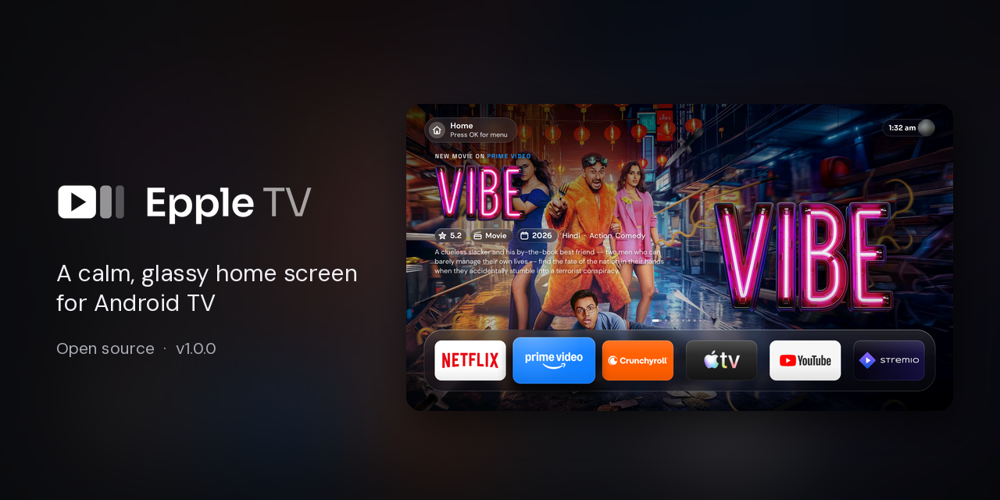
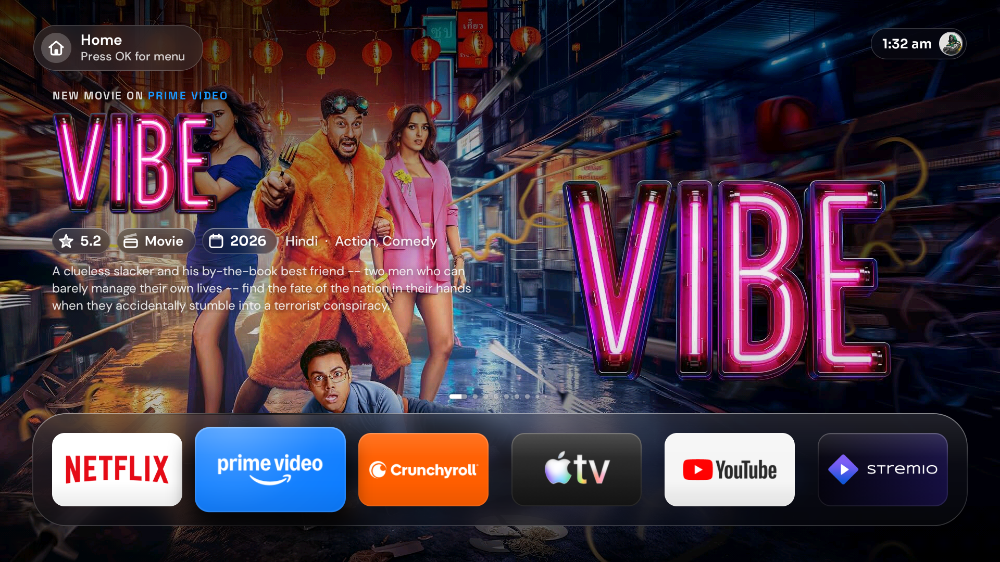
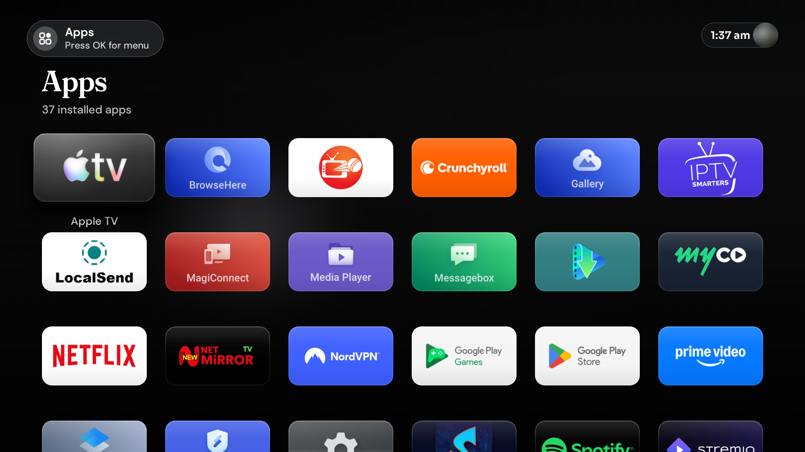
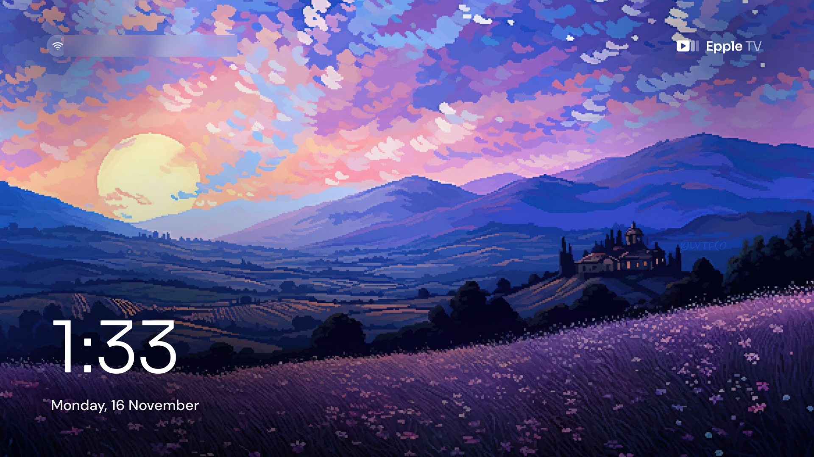

<p align="center">
  
</p>

<p align="center">
  <a href="https://github.com/muhibtasam/epple-tv-launcher/releases/latest"></a>
  
  
  
  <a href="LICENSE"></a>
</p>

# Epple: a personalized, ad-free Android TV launcher

**Epple is a free, open-source home screen (launcher) for Android TV and Google TV.** It brings your streaming apps,
personalized recommendations and Continue Watching together on one clean, cinematic home screen, so you spend less time
jumping between apps to decide what to watch.

Epple is built for people who use several streaming apps, such as Netflix, Prime Video, Crunchyroll, YouTube and Stremio.
It learns what you like from what you watch, save and skip, and suggests titles from the services you actually have. The
interface is inspired by premium streaming-device design, in the spirit of an Apple TV-style home screen, but Epple is
its own product and runs on Android TV.

Epple is **not a streaming service**. It does not host, sell or play movies and shows. When you pick a title, Epple opens
it in the streaming app that has it, and playback, subscriptions and sign-ins stay with that app.

> Epple is an independent open-source project. It is not affiliated with, endorsed by or connected to Apple, Google,
> TMDB, JustWatch or any streaming service. Epple does not run on Apple TV, tvOS or other Apple hardware. App names
> and logos shown belong to their owners.

## Contents

- [Key features](#key-features)
- [Personalized recommendations](#personalized-recommendations)
- [Continue Watching and content discovery](#continue-watching-and-content-discovery)
- [Streaming app integration](#streaming-app-integration)
- [Control Center and notifications](#control-center-and-notifications)
- [Screensaver and customization](#screensaver-and-customization)
- [Screenshots](#screenshots)
- [Installation](#installation)
- [Supported devices and requirements](#supported-devices-and-requirements)
- [Build from source](#build-from-source)
- [API keys and content providers](#api-keys-and-content-providers)
- [Privacy and permissions](#privacy-and-permissions)
- [Credits and attribution](#credits-and-attribution)
- [Limitations and roadmap](#limitations-and-roadmap)
- [License](#license)

## Key features

- **Personalized recommendations:** Top Picks for You, "Because you watched …" rows and Your Watchlist, built from your
  own viewing and feedback.
- **No ads:** no advertisements, no sponsored rows and no paid placements on the home screen.
- **All your streaming apps in one row,** with a showcase of what is new and popular on the app you focus.
- **Continue Watching** with real progress, the episode you are on, and only what you watched recently.
- **Control Center** for Wi-Fi, standby, inputs, volume, sleep timer and shortcuts.
- **Notifications** from your apps, shown as a short popup and in Control Center.
- **Screensaver** with your own pictures, the time and the date.
- **Made for the TV remote:** smooth, glass-style interface with focus states designed for D-pad navigation.

## Personalized recommendations

Epple's recommendations answer one question: *what should I watch next?* They are real movie and TV titles from
[TMDB](https://www.themoviedb.org/), chosen for you and kept on your TV.

**What Epple learns from**
- **What you watch.** A title counts once you start it from Epple and its app reports about 30 seconds of real playback.
  Trailers and short previews are ignored.
- **Your Favourites and Watchlist.** Titles you save are strong signals.
- **Titles you look at.** Opening a title's details counts a little, for a short time.
- **Your feedback.** *More like this* asks for similar titles soon; *Not for me* removes a title and weighs its genres
  less for a while.
- **Your streaming apps.** Picks favour titles that stream on the apps you pinned, in the region you choose.

Older signals fade over time (about two months), so recommendations follow your current taste.

**What you see**
- **Top Picks for You:** a mix of titles chosen for you, rotated so the row does not repeat the same picks every day.
- **Personal rows** with a reason, for example *Because you watched …*, *Because you love …*, *Because … is on your
  Watchlist* or *More like …*.
- **Your Watchlist.**

**What recommendations are not**
- They are **not paid placements or sponsored content**. Picks are scored only from your own signals and TMDB's title
  data (genres, related titles, people and franchises) plus streaming availability.
- They do **not** use AI models in v1.0. Scoring uses fixed rules that run on the TV.
- Recommending a title does **not** mean you can watch it for free. You need the streaming app and, where required, its
  subscription.

Recommendations, showcases and search need a free TMDB API key (see
[API keys and content providers](#api-keys-and-content-providers)).

## Continue Watching and content discovery

**Continue Watching** shows what you were watching in your apps, so you can resume with one click:

- Progress bars use the app's own player position when the app reports it.
- For shows, Epple shows the episode you are on. When you finish an episode, it moves to the next one that has aired.
- Finished titles drop off, and only titles you watched in the last 14 days are listed.
- Hold OK on a title to remove it.

Continue Watching depends on what each streaming app publishes to Android TV. Some apps publish nothing, and some publish
out-of-date rows. Epple corrects these where the app's player reports what is playing, but only for viewing that happens
while Epple is installed.

**Content discovery**
- For the app you focus, Epple shows a rotating showcase of new and popular titles with artwork, logo, rating, type,
  year and a short summary.
- Press Up for the full artwork; Play opens the title in its app.
- **Search** finds movies and shows (needs a TMDB key).
- Hold OK on any title for Details, Watchlist and Favourites.

## Streaming app integration

- Pin your favourite streaming apps to the top row. Hold OK on an app to open, move, pin or unpin it, view its info or
  uninstall it.
- The **Apps** page lists every installed app in one grid.
- When a title is confirmed on one of your services, Epple names that service. Availability follows the region you
  choose (or the TV's region) and comes from TMDB's watch providers, powered by **JustWatch**.
- Opening a title goes straight to it in apps that support direct links; other apps open at their home screen.

## Control Center and notifications

**Control Center** gathers everyday TV controls in one panel: Wi-Fi status, Standby, Inputs, Volume and Sleep Timer,
plus shortcuts to the Screensaver, Bluetooth & Accessories, Epple's settings and the TV's own settings.

**Notifications**
- Notifications from your other apps, as a short popup and in Control Center, once you allow notification access.
- Optional notes from Epple itself: Wi-Fi lost and restored, new seasons, episodes or franchise movies for titles you
  follow, and a new Epple release (checked once a day on this repository's GitHub Releases).

## Screensaver and customization

- **Screensaver:** your own pictures (or your wallpapers) full screen with the time, date and network after the TV is
  idle, with a slow pan or a still image. Any button returns to where you were.
- **Personal touches:** your own wallpapers, profile picture and screensaver pictures, sent from your phone by scanning a
  QR code on the TV.
- **Settings** for clock format, artwork rotation, glass strength, text size and weight, region, notifications and more.

## Screenshots

| | |
|---|---|
|  |  |
| **Home:** your streaming apps in a glass row, with artwork, rating and a summary for what is new or popular on the focused app. | **Full artwork:** press Up for the full picture of the current title, with Play to open it in its app. |
|  |  |
| **Menu:** Home, Apps and Search, opened from the Home badge. | **Apps:** every installed app in one grid. |
|  |  |
| **Control Center:** Wi-Fi, standby, inputs, volume, sleep timer and shortcuts. | **Screensaver:** your pictures with the time and date. |

*Screenshots were taken from the running app on an Android TV device. The Wi-Fi name and profile picture are blurred for privacy.
The wallpapers are the owner's own pictures; Epple ships without wallpapers.*

## Installation

1. Download `epple-tv-1.0.0.apk` from the
   [latest release](https://github.com/muhibtasam/epple-tv-launcher/releases/latest).
2. Copy it to the TV (for example with a USB drive or a file-sharing app such as LocalSend) and open it with a file
   manager, allowing installs from that app when Android asks. Or, from a computer with
   [adb](https://developer.android.com/tools/adb): `adb install epple-tv-1.0.0.apk`.
3. Open Epple from your TV's apps (in v1.0 the app is listed as **Epple TV**). A short first-launch setup walks you
   through providers, what you watch and the home screen.
4. Add your TMDB key in **Settings › Content providers** to turn on recommendations, showcases and search.
5. Optional: in **Settings › Home screen**, make Epple open when you press the remote's Home button.

## Supported devices and requirements

- **Android TV or Google TV** device running **Android 8.0 (API 26) or later**.
- Tested on **Android 14** (Google TV) on a **16:9 display**.
- Device compatibility may vary depending on Android TV version and manufacturer. Compatibility reports are welcome in
  [Issues](https://github.com/muhibtasam/epple-tv-launcher/issues).
- Internet access for artwork, recommendations and availability.
- The APK is universal (no native code), so it runs on any CPU type.

## Build from source

**Tools**
- JDK 17 or later
- Android SDK with platform 37 (Android Studio, or the command-line tools)
- A macOS or Linux shell (`scripts/build.sh` uses macOS `sips` only to pack optional wallpapers; with no `wallpapers/`
  folder that step does nothing)

**Build**
```bash
git clone https://github.com/muhibtasam/epple-tv-launcher.git
cd epple-tv-launcher
echo "sdk.dir=/path/to/your/Android/sdk" > local.properties   # or set ANDROID_HOME
bash scripts/build.sh
```
`build.sh` runs the unit tests and builds both flavours into `out/`:
- `out/epple-tv-base-release.apk`: the published build (no Google dependencies)
- `out/epple-tv-google-release.apk`: the same app, a flavour reserved for Google TV capabilities

With Gradle alone: `./gradlew testBaseDebugUnitTest assembleBaseRelease` (APK in `app/build/outputs/apk/base/release/`).

**Install your build:** `adb install -r out/epple-tv-base-release.apk`

**Optional build settings** in `local.properties` (never committed): `tmdb_key`, `watchmode_key`, `trakt_client_id`,
`youtube_key` and `content_region` become built-in defaults. Do not share an APK built with your own keys: anyone can read
them from the APK. Pictures in a `wallpapers/` folder are packed in as default wallpapers.

Release builds are signed with the Android debug key (see `app/build.gradle.kts`).

**How it is built**
- **Kotlin** with Android's platform **Views**: no Compose, no Leanback library and no third-party runtime dependencies
  (JUnit for tests only).
- Custom spring-based motion, a shared frame clock, and one glass material (a pre-blurred texture of the backdrop drawn
  under every glass surface).
- `home/`: screens, rows, hero, Control Center, settings and setup. `content/`: catalogues, recommendations, TV listings,
  Continue Watching, credentials and the cached network layer. `system/`: notifications, TV controls and home screen
  switching. `pair/`: the phone setup page and QR pairing.
- Network responses are cached on disk and de-duplicated, and disk and network work stays off the main thread.
- Internal names (the `com.eppletv.launcher` package, APK file names and this repository's name) keep "tv" for
  compatibility; the product name is Epple.

## API keys and content providers

Artwork, summaries, recommendations, search and availability come from [TMDB](https://www.themoviedb.org/), which needs a
free personal API key. **The release APK contains no keys.** Add yours in **Settings › Content providers**; you can type
it on your phone by scanning the QR code on the TV.

Watchmode, Trakt and YouTube keys are optional extras. Keys you enter are stored encrypted on the TV with a key from the
Android Keystore.

Without a TMDB key, Epple still works as a launcher: apps, Control Center, notifications, screensaver and Continue
Watching from your apps. Showcases, recommendations and search stay empty.

## Privacy and permissions

**What Epple does not do**
- No advertisements and no sponsored or paid rows.
- No analytics, tracking or crash-reporting libraries, and no Epple account or Epple server.

**What stays on your TV**
- Your viewing signals, Favourites, Watchlist, feedback and recommendations are stored on the TV.
- The phone setup page (for keys and pictures) is served by the TV itself on your local network while the QR code is
  shown.

**What goes over the internet**
- Requests to the content providers you use (TMDB, and optionally Watchmode, Trakt and YouTube) to fetch title data and
  artwork. Those services receive the requests under their own privacy policies.
- Public catalogue data for some app showcases (for example Stremio's public catalogue and a Netflix Top 10 list hosted
  on GitHub Pages).
- A once-a-day check of this repository's GitHub Releases for updates.

Your streaming apps are separate apps with their own terms, ads policies and data practices; Epple does not change them.

**Permissions**
- **Internet** and **network state:** content data, and the Wi-Fi status in Control Center.
- **TV listings** (asked inside Epple): to read what your apps publish to Android TV, such as their Continue Watching
  rows.
- **Install and delete packages:** to install Epple updates you choose and to uninstall apps you pick from the app menu.
  Android asks you to confirm each one.
- **Notification access** (optional, granted in Android settings): to show other apps' notifications.
- **Use as the Home screen** (optional): Settings › Home screen makes the Home button open Epple. On Google TV this turns
  off the Google TV home screen (it stays installed and can be turned back on from the same setting) and asks the TV to
  allow debugging once.

## Credits and attribution

- This product uses the **TMDB API** but is not endorsed or certified by TMDB. Movie and TV data and artwork are from
  [The Movie Database](https://www.themoviedb.org/).
- Streaming availability: **JustWatch**, via TMDB's watch providers.
- Optional providers: [Watchmode](https://www.watchmode.com/), [Trakt](https://trakt.tv/) and the
  [YouTube Data API](https://developers.google.com/youtube/v3).
- Stremio showcase: Stremio's public Cinemeta catalogue and its artwork.
- Fonts: **DM Sans**, **Fraunces**, **Sora** and **Space Grotesk**, under the SIL Open Font License (licence texts in
  `app/src/main/assets/fonts/`).
- The pixel-art wallpaper in the menu and screensaver screenshots is the owner's picture by its artist (signed @LVTECO);
  it is not part of the app.

## Limitations and roadmap

**Current limitations**
- Tested on Android 14 on a 16:9 display; compatibility may vary by Android TV version and manufacturer.
- Recommendations, showcases, search and availability need your own TMDB API key.
- Continue Watching depends on what each app publishes to Android TV (see above).
- Direct links to a title work only in apps that support them; otherwise the app opens at its home.
- The **Movies** and **TV Shows** sections are not available in v1.0. Their code is in this repository, but they are
  hidden until a future release.
- APKs are signed with a debug key; if the signing key changes in a future version, you will need to reinstall.

**Roadmap**
- Bring back the Movies and TV Shows sections.
- Broaden testing across Android TV versions and devices.
- Keep refining recommendations and Continue Watching.

## License

[MIT](LICENSE) © 2026 Muhammad Ibtasam
